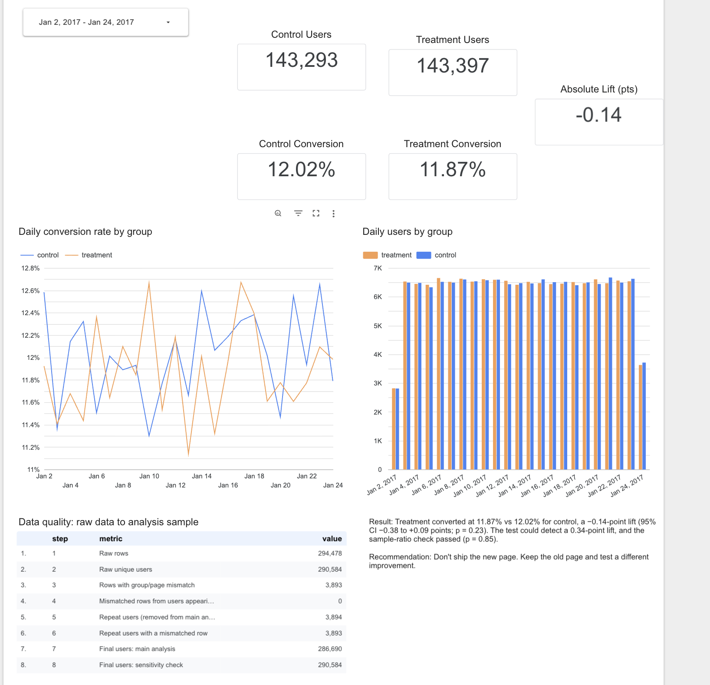
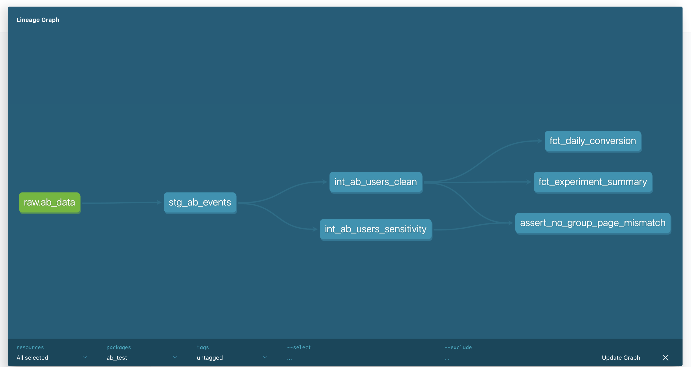
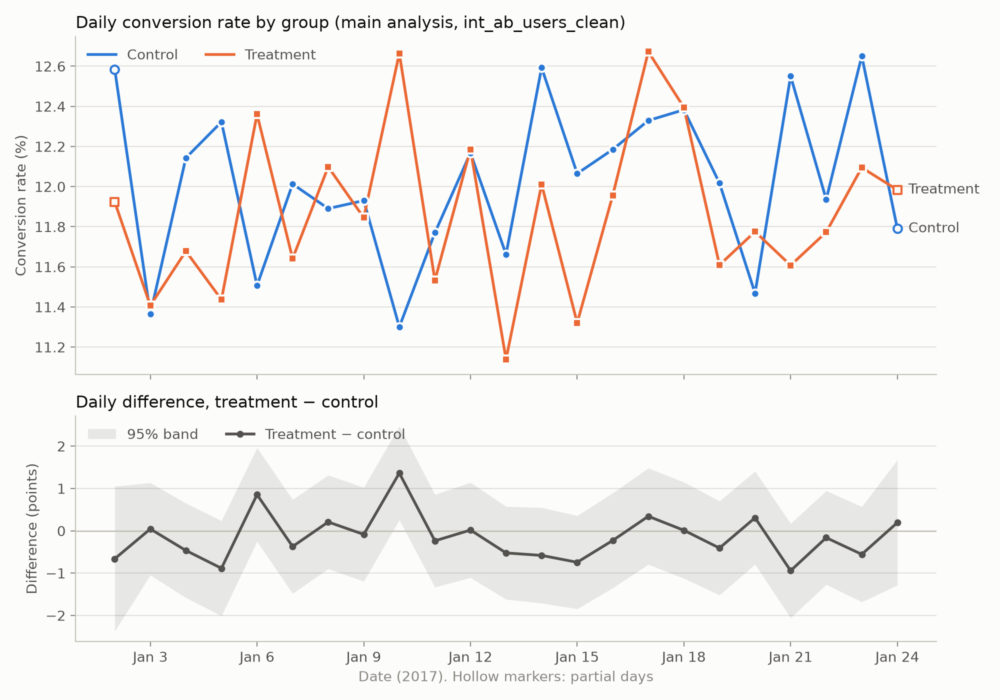

# E-commerce Landing Page A/B Test Analysis

**Did a new landing page increase conversion? No.** Across 286,690 users, the new page converted at 11.87% vs 12.02% for the old page (−0.14 points, 95% CI −0.38 to +0.09, p = 0.23), and the test was large enough to have caught any lift worth shipping.

**[Live dashboard (Looker Studio)](https://datastudio.google.com/reporting/ca606f25-be48-445b-8f42-b6a8408d8bf9/page/deuBG)**



| At a glance | |
|---|---|
| Question | Does the new landing page convert better than the old one? |
| Answer | No: −0.14 points, not significant; gains above +0.09 points are ruled out |
| Data quality | 3,893 rows showed the wrong page for their group; all belonged to 3,894 users logged twice, who were removed |
| Validity checks | Sample-ratio check passed (p = 0.85); no novelty effect; same conclusion with repeat users kept |
| Stack | BigQuery · dbt · Python (statsmodels) · Looker Studio |

## Business question

An e-commerce company tested a redesigned landing page against its existing page. Users were randomly assigned to **control** (old page) or **treatment** (new page). Should the new page ship?

The analysis plan was pre-registered in the notebook and committed before any results were computed: two-sided two-proportion z-test, alpha = 0.05, conversion rate as the primary metric, main analysis on the cleaned table, and a sensitivity check on an alternative cleaning rule.

## Data

- **Source:** [ab_data.csv on Kaggle](https://www.kaggle.com/datasets/surajsingh83/ab-data-csv) by Suraj Singh (@surajsingh83) (originally from Udacity's A/B testing course)
- **Size:** 294,478 rows, 5 columns: `user_id`, `timestamp`, `group`, `landing_page`, `converted`
- **Period:** 2017-01-02 13:42 to 2017-01-24 13:41 (22 days; first and last days are partial)
- The CSV is not committed; download it to `data/raw/ab_data.csv` (see How to reproduce).

## Data quality findings

| Step | Count |
|---|---:|
| Raw rows | 294,478 |
| Raw unique users | 290,584 |
| Rows where group and page don't match (control saw new page, or treatment saw old page) | **3,893** |
| Users logged twice | **3,894** |
| …of whom had a mismatched row | 3,893 |
| Mismatched rows from users logged once | 0 |
| **Final users, main analysis** | **286,690** (143,293 control / 143,397 treatment) |
| Final users, sensitivity check | 290,584 (145,274 / 145,310) |

**Key finding:** the duplicates and the mismatches are the same problem. Every mismatched row belongs to a user who appears twice, and 1,895 of those users were recorded in *both* groups. Because they may have seen both pages, the main analysis excludes all repeat users. The sensitivity check keeps their correctly assigned row instead, and reaches the same conclusion.

These counts are enforced by dbt tests: `int_ab_users_clean` must have unique users and zero mismatches, and `fct_data_quality_summary` fails the build if any count drifts from the values above.

## Pipeline

```
Kaggle CSV ──bq load──▶ BigQuery raw.ab_data
                          │
                          ▼  dbt (ab_dbt dataset)
            stg_ab_events (view: rename, type, flag mismatches)
                 │                              │
                 ▼                              ▼
     int_ab_users_clean            int_ab_users_sensitivity
     (repeat users excluded)       (repeat users kept, correct row)
                 │
                 ▼
     fct_daily_conversion · fct_experiment_summary · fct_data_quality_summary
                 │
        ┌────────┴─────────┐
        ▼                  ▼
  Python notebook     Looker Studio
  (stats, memo)       (dashboard)
```



**dbt build:** 6 models and 18 tests (PASS=23, WARN=1). The one warning is intentional: a `unique` test on staging, set to *warn*, documents the 3,894 duplicate users on every run without blocking the build.

## Results

| | Main analysis (repeat users excluded) | Sensitivity (repeat users kept) |
|---|---|---|
| Users (control / treatment) | 143,293 / 143,397 | 145,274 / 145,310 |
| Conversion (control / treatment) | 12.02% / 11.87% | 12.04% / 11.88% |
| Absolute lift | **−0.14 points** | −0.16 points |
| Relative lift | −1.20% | −1.31% |
| z, p-value | z = −1.19, **p = 0.23** | z = −1.31, p = 0.19 |
| 95% CI for the difference | **−0.38 to +0.09 points** | −0.39 to +0.08 points |
| Sample-ratio check | p = 0.85 (pass) | p = 0.95 (pass) |

**Was the test big enough?** Yes. With about 143,000 users per group, the test had 80% power to detect a lift as small as **0.34 points**. It had 2.1× the users needed to detect +0.5 points, 8.3× for +1 point, and 32× for +2 points. So "not significant" here means *no meaningful effect*, not *test too small*.

**Novelty effect?** No. The lift was −0.135, −0.123 and −0.175 points in the first, second and third periods of the test, and the daily difference shows no trend (−0.010 points/day, p = 0.58).



## Recommendation

### A/B Test Results Memo

**1. Decision.** We should not ship the new page. It shows no meaningful conversion improvement over the existing page.

**2. What was tested.** We compared the old and new pages from January 2–24, 2017, analyzing 286,690 users: 143,293 control and 143,397 treatment.

**3. Data quality.** We removed 3,894 repeat users, including 3,893 with a row assigned to the wrong group, because they may have seen both pages. The sample-ratio mismatch check passed (p = 0.85), confirming a fair group split.

**4. Result.** Conversion was 12.02% for control versus 11.87% for treatment, a −0.14-point difference—about 14 fewer conversions per 10,000 visitors. The 95% confidence range (−0.38 to +0.09 points) and p-value (0.23) indicate no statistically significant difference.

**5. Why it’s a real answer.** The test could detect a lift of just 0.34 points, and the confidence range rules out gains above 0.09 points. If the new page helped by any amount worth shipping, this test would very likely have detected it.

**6. Robustness.** Including repeat users gives the same conclusion (−0.16 points, p = 0.19). Results were slightly negative in all three weeks, with no sign of a novelty effect.

**7. Next step.** Keep the old page and test a different improvement, such as pricing presentation or checkout design.

## How to reproduce

1. **Environment** (conda):
   ```bash
   conda env create -f environment.yml
   conda activate abtest
   ```
2. **Data:** download `ab_data.csv` from the Kaggle link above into `data/raw/ab_data.csv` (git-ignored), then profile it:
   ```bash
   python scripts/01_profile_raw.py
   ```
3. **Google Cloud:** create a project, open BigQuery (the free sandbox works), and log in:
   ```bash
   gcloud auth login
   gcloud auth application-default login
   gcloud config set project YOUR_PROJECT_ID
   ```
4. **Load into BigQuery:**
   ```bash
   bq mk --location=US --dataset YOUR_PROJECT_ID:raw
   bq load --location=US --source_format=CSV --autodetect --skip_leading_rows=1 YOUR_PROJECT_ID:raw.ab_data data/raw/ab_data.csv
   ```
   `sql/01_raw_profile.sql` should then show 3,893 mismatched rows and a 3,894-row gap between rows and users.
5. **dbt:** create `~/.dbt/profiles.yml` (kept outside the repo):
   ```yaml
   ab_test:
     target: dev
     outputs:
       dev:
         type: bigquery
         method: oauth
         project: YOUR_PROJECT_ID
         dataset: ab_dbt
         location: US
         threads: 4
   ```
   then build and test everything:
   ```bash
   cd ab_test && dbt build
   ```
   Expected: PASS=23, WARN=1. To use your own data, update the expected counts in `tests/assert_data_quality_counts_match_claude_md.sql`.
6. **Notebook:** set `PROJECT` in the first code cell to your project ID, then run all cells in `notebooks/ab_test_analysis.ipynb`.

> **BigQuery sandbox expiry:** sandbox tables delete themselves automatically (60 days by default). This project's tables expire on **2026-12-20**, after which the live dashboard goes blank; the screenshot above is the permanent record. To restore it, re-run steps 4 and 5, or enable billing on the project (usage at this size stays within the free tier).

## Repository layout

```
├── ab_test/                 dbt project (models, tests)
├── notebooks/               ab_test_analysis.ipynb (pre-registration, stats, memo)
├── scripts/01_profile_raw.py
├── sql/01_raw_profile.sql
├── images/                  dashboard, lineage, daily conversion chart
└── environment.yml          conda environment
```

## Tools

Google BigQuery · dbt (dbt-bigquery) · Python (pandas, SciPy, statsmodels, matplotlib) · Jupyter · Looker Studio · conda · GitHub
